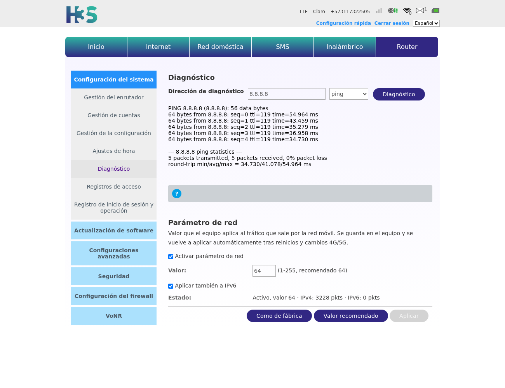

# Implementation instructions: "Network parameter" (configurable outbound TTL)

**Product:** Notion 5G CPE (H3S P52HL, ASR1901) · **Requested by:** H3S (Colombia)
**Goal:** include this feature in the next firmware build, so it is present after a factory reset.

This package is a complete, tested reference implementation. It has been running on a production unit
(firmware built 2026-08-17): web UI, reboots, 4G/5G changes and every automated check pass. Please
integrate it **as it is**.

| Document | What it is |
|---|---|
| `IMPLEMENTATION.md` | this document: how to put it in the firmware, step by step |
| `REQUIREMENTS.md` | how the device must look and behave when you are done (R0–R12), and how to check it |
| `OEM-SPEC.md` | full specification: design, rules, security, and the reasons behind each decision |



## What the feature does

- Rewrites the TTL (IPv4) and Hop Limit (IPv6) of every packet that leaves through the cellular interface
  (`ccinet+`) to a configurable value. Default **64**.
- Optionally also rewrites incoming packets, so a ping shows the configured value (default on).
- The value is stored in `/etc/config/netparam` and survives reboots and every 4G/5G re-attach.
- The user changes it in the web UI: **Router → System Settings → Diagnostics**, section **"Parámetro de
  red"** ("Network parameter" in English), below the ping form.

## Product requirements (do not change)

1. **No menu entry of its own.** The section appears inside the existing Diagnostics page.
   `xml/ui_mifi.xml`, `diagnostics.html` and `diagnostics.js` are **not** modified.
2. **The UI text never says "TTL" or "Hop Limit"**, in any language. The UI strings are in Spanish (main
   language), English and Chinese: use them exactly as provided.
3. **Neutral internal names.** Everything is called `netparam`: files, uci config, firewall include,
   iptables comment, syslog tag, JSON fields, element ids, string keys. Keep these names.

## Package contents

```
files/                 the final files, at their exact path on the device  ->  goes into the image
  system/etc/config/netparam                         new       0644
  system/etc/config/firewall                         modified  0644  (factory file + 1 include section)
  system/etc/firewall.netparam.sh                    new       0755
  system/etc/www/netparam.cgi                        new       0755
  system/etc/www/index.html                          modified  0644  (factory file + 1 <script> line)
  system/etc/www/html/router/netparam.html           new       0644
  system/etc/www/js/panel/router/netparam.js         new       0644
  system/etc/www/properties/Messages_es.properties   modified  0644  (factory file + 15 strings)
  system/etc/www/properties/Messages_en.properties   modified  0644  (factory file + 15 strings)
  system/etc/www/properties/Messages_cn.properties   modified  0644  (factory file + 15 strings)
MANIFEST.md5           expected MD5 of the files on the device (see REQUIREMENTS.md R0)
merge/                 only needed if your own versions of the modified files differ (step 2, option B)
  apply-to-rootfs.sh   merges the changes into your files and adds the new ones
  i18n/                the 15 UI strings per language, to append
  web-ui-existing-files.patch   the same changes as a unified diff, for reference
tools/                 run from a Linux PC against a unit (not for the image)
  verify.sh            checks a unit against REQUIREMENTS.md (R0-R8)
  test_cgi.py          backend acceptance tests
  test_ui.py           web UI test in Chromium (R9-R10)
  install.sh           installs on a running unit over SSH, to evaluate before building
  rsh.sh, web_login.py, verify-device.sh   helpers
VERSION.txt            package version and source revision
```

`files/` mirrors the device filesystem exactly: `files/X` is `/X` on the device. On this firmware, `/www`
and `/etc/config` are symlinks into `/system/etc` (`/www -> /system/etc/www`,
`/etc/config -> /system/etc/config`), so everything is under `system/etc/`.

## Step 1 — check your base

Compare your sources for these 5 files with the factory files of the firmware built 2026-08-17:

- `/system/etc/www/index.html`
- `/system/etc/www/properties/Messages_es.properties`
- `/system/etc/www/properties/Messages_en.properties`
- `/system/etc/www/properties/Messages_cn.properties`
- `/system/etc/config/firewall`

If they are the same → **option A**. If you have changed any of them since → **option B**.

## Step 2 — put the files in the image

### Option A — copy `files/` as it is (base unchanged)

Copy the whole `files/` tree over the root filesystem of the image, keeping the modes listed above. In an
OpenWrt buildroot, the top-level `files/` directory exists for exactly this: its contents are copied into the
root filesystem of the image as they are. For example:

```
cp -a files/. <openwrt>/files/
```

Or copy it into your rootfs staging directory before the image is packed.

### Option B — merge into your own files (base changed)

1. Copy only the 5 **new** files from `files/`: `config/netparam`, `firewall.netparam.sh`, `netparam.cgi`,
   `html/router/netparam.html`, `js/panel/router/netparam.js`.
2. Apply the changes to your versions of the other 5 files.

`merge/apply-to-rootfs.sh` does both steps on a root filesystem tree:

```
merge/apply-to-rootfs.sh <rootfs>     # <rootfs> = the directory that becomes "/" in the image
```

It checks that the expected files exist, can be run more than once, and touches nothing outside `<rootfs>`.
To do it by hand instead:

| File | Change |
|---|---|
| `/system/etc/www/index.html` | Right after the line that loads `js/panel/router/sipalg.js`, add:<br>`<script type="text/javascript" src="js/panel/router/netparam.js" language="javascript"></script>` |
| `/system/etc/www/properties/Messages_{es,en,cn}.properties` | Append the 15 lines of `merge/i18n/Messages_{es,en,cn}.properties`. The factory files do not end with a newline, so make sure the first appended line starts on a new line. |
| `/system/etc/config/firewall` | Append the `config include 'netparam'` section shown in REQUIREMENTS.md R3. |

## Step 3 — do NOT change these

- `/system/etc/www/xml/ui_mifi.xml`: no menu entry.
- `/system/etc/www/html/router/diagnostics.html` and `/system/etc/www/js/panel/router/diagnostics.js`.
  `netparam.js` adds the section to the Diagnostics page at runtime, by wrapping `$.fn.objDiagnostics`.
- The strings: do not translate them again and do not add the words "TTL" or "Hop Limit".
- The include option `reload '1'` in `config/firewall`. Every cellular re-attach (4G↔5G, signal loss, SIM
  change) brings `wan0` up again, and the hotplug script runs `fw3 reload`, which flushes the mangle table.
  With `reload '1'`, fw3 re-runs our script every time and the rules come back.

## Step 4 — build

Kernel support needed (already in the current image): iptables `TTL` target, ip6tables `HL` target and the
`comment` match. Recommended: include `/etc/config/netparam` in the configuration backup and restore
(`conf_management`).

## Step 5 — verify on a unit with the new firmware

From a Linux PC connected to the unit's LAN, with the SIM inserted and mobile data up:

```
NOTION_PASS=<root password> tools/verify.sh            # R0-R8: files, checksums, config, rules, ping, fw3 reload
NOTION_PASS=<root password> python3 tools/test_cgi.py  # backend: session, CSRF, validation, all settings
NOTION_PASS=<root password> python3 tools/test_ui.py   # web UI in Chromium: R9-R10, in Spanish, English and Chinese
```

Each one prints `ALL OK` when everything passes. `test_ui.py` needs Python 3 plus
`pip install playwright && playwright install chromium`. The tests change the value while they run and
leave the unit at 64. The web login defaults to admin/admin (override with `NOTION_HTTP_USER` /
`NOTION_HTTP_PASS`). Careful: several failed web logins in a row lock the login for a while.

Then, by hand:

1. Reboot. `tools/verify.sh` must pass again.
2. Set 70 in the web UI and reboot. The section must still show 70, and `ping 8.8.8.8` on the unit must show
   `ttl=70`.
3. Do a factory reset. The value must be back to 64, and `tools/verify.sh` must pass.

## Sign-off checklist

- [ ] `files/` in the image (option A), or the 5 new files plus the merged changes (option B)
- [ ] `ui_mifi.xml` and the Diagnostics files unchanged
- [ ] `tools/verify.sh`: `ALL OK`
- [ ] `tools/test_cgi.py` and `tools/test_ui.py`: `ALL OK`
- [ ] Value kept after reboot; back to 64 after a factory reset

Please send H3S the firmware version that includes this feature, so we can run the same checks before
release.
