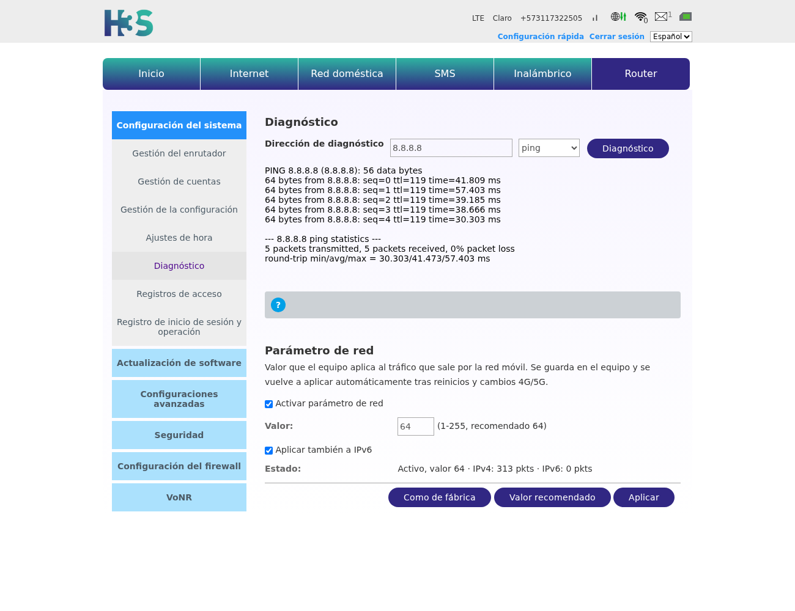

# Solicitud de función: TTL / Hop Limit de salida configurable por el usuario (Notion 5G, H3S P52HL, ASR1901)

**Solicitado por:** H3S (Colombia) · **Para:** la próxima versión de firmware del CPE Notion 5G
**Estado:** implementación de referencia completa, funcionando en un equipo de producción (firmware compilado el
2026-08-17). Todo lo que sigue se probó en hardware real. La integración puede copiarla tal cual o reimplementarla
de forma nativa.



## 0. Manifiesto de archivos — qué va dónde

Todas las rutas de destino son **rutas absolutas dentro de la imagen del equipo**. Todo vive bajo **`/system/etc`**:
`/www` y `/etc/config` son solo enlaces simbólicos hacia ahí (`/www -> /system/etc/www`,
`/etc/config -> ../system/etc/config`). **No poner archivos directamente en `/etc`**: es el squashfs de solo lectura.

La carpeta `rootfs/` del paquete replica exactamente el sistema de archivos del equipo: `rootfs/system/etc/X` va a
`/system/etc/X`.

### 0.1 Archivos NUEVOS que hay que agregar a la imagen

| # | Origen en el paquete | Destino en la imagen | Permisos | Tipo | Opción A | Opción B |
|---|---|---|---|---|---|---|
| 1 | `rootfs/system/etc/config/netparam` | `/system/etc/config/netparam` | 0644 | Configuración, valor de fábrica | ✔ | ✔ |
| 2 | `rootfs/system/etc/firewall.netparam.sh` | `/system/etc/firewall.netparam.sh` | 0755 | Script de firewall, aplica las reglas | ✔ | ✔ |
| 3 | `rootfs/system/etc/www/html/router/netparam.html` | `/system/etc/www/html/router/netparam.html` | 0644 | Marcado de la sección de la **interfaz web** (se muestra dentro de Diagnóstico) | ✔ | ✔ |
| 4 | `rootfs/system/etc/www/js/panel/router/netparam.js` | `/system/etc/www/js/panel/router/netparam.js` | 0644 | Lógica de la **interfaz web** y el enganche que agrega la sección a Diagnóstico | ✔ | ✔ (cambiar las llamadas a `PostXml`) |
| 5 | `rootfs/system/etc/www/netparam.cgi` | `/system/etc/www/netparam.cgi` | 0755 | Backend web (CGI en shell) | ✔ | ✘ no hace falta |

### 0.2 Archivos EXISTENTES que hay que modificar

Los cambios exactos están en `web-ui-existing-files.patch` (diff contra los archivos de fábrica).

| # | Archivo en la imagen | Tipo | Cambio |
|---|---|---|---|
| 6 | `/system/etc/www/index.html` | **Interfaz web** | Agregar 1 línea justo después de la de `js/panel/router/sipalg.js`: `<script type="text/javascript" src="js/panel/router/netparam.js" language="javascript"></script>` |
| 7 | `/system/etc/www/properties/Messages_es.properties` | Textos de la **interfaz web** (español) | Agregar al final las 14 líneas de `i18n/Messages_es.properties` |
| 8 | `/system/etc/www/properties/Messages_en.properties` | Textos de la **interfaz web** (inglés) | Agregar al final las 14 líneas de `i18n/Messages_en.properties` |
| 9 | `/system/etc/www/properties/Messages_cn.properties` | Textos de la **interfaz web** (chino) | Agregar al final las 14 líneas de `i18n/Messages_cn.properties` |
| 10 | `/system/etc/config/firewall` (valores de fábrica) | Configuración del firewall | Agregar al final la sección de abajo |

**No** agregar una entrada de menú: `/system/etc/www/xml/ui_mifi.xml` queda como está. El ajuste no tiene una
opción propia en el menú. Aparece como una sección al final de la página existente de **Diagnóstico** (ver la
sección 4). Tampoco hay que modificar `diagnostics.html` ni `diagnostics.js`: `netparam.js` agrega la sección
al cargar la página.

Sección que se agrega a `/system/etc/config/firewall`:

```
config include 'netparam'
	option type 'script'
	option path '/system/etc/firewall.netparam.sh'
	option reload '1'
	option family 'any'
```

### 0.3 Archivos que NO van en la imagen

`OEM-SPEC*.md`, `README.md`, `screenshot-netparam.png`, `web-ui-existing-files.patch`, `i18n/` (origen de las
filas 7–9), `install.sh` (instalador de campo por SSH), `test_cgi.py` y `test_ui.py` (pruebas que se corren desde
un PC).

### 0.4 Comprobación final en el equipo

```
ls -l /system/etc/config/netparam /system/etc/firewall.netparam.sh \
      /www/html/router/netparam.html /www/js/panel/router/netparam.js /www/netparam.cgi
uci show netparam; uci show firewall.netparam
iptables -t mangle -S POSTROUTING | grep netparam     # esperado: --ttl-set 64
ip6tables -t mangle -S POSTROUTING | grep netparam    # esperado: --hl-set 64
```

## 1. Qué necesitamos

1. El TTL (IPv4) y el Hop Limit (IPv6) de todo paquete que **sale por la interfaz celular** deben reescribirse a un
   **valor configurable**. Valor por defecto: **64**, igual que un celular Android/iOS.
2. El valor se **guarda en un archivo de configuración**: un archivo uci que se conserva tras reinicios, entra en
   el respaldo y la restauración de configuración, y vuelve al valor por defecto con un reset de fábrica.
3. El usuario puede cambiarlo desde la **interfaz web**, en una sección al final de la página existente de
   Diagnóstico: Router → Configuración del sistema → Diagnóstico → "Parámetro de red".
4. **Textos de la interfaz (requisito del producto):** los textos visibles no deben contener las palabras "TTL"
   ni "Hop Limit" en ningún idioma. El ajuste se llama "Parámetro de red" / "Network parameter" / "网络参数" y el
   campo "Valor". Usar los textos de `i18n/` exactamente como se entregan.
5. **Nombres internos (requisito del producto):** nada que un usuario o un operador pueda ver en el equipo puede
   nombrar la función. Todo usa el nombre neutro **`netparam`**: los archivos (`netparam.cgi`, `netparam.js`,
   `netparam.html`, `firewall.netparam.sh`), la configuración uci `/etc/config/netparam` (opción `value`, no
   `ttl`), el include de fw3 `firewall.netparam`, el comentario de iptables, la etiqueta de syslog, los campos del
   JSON, los ids de los elementos y las claves de texto. Los archivos que se entregan al navegador
   (`netparam.js`, `netparam.html`) y el JSON no deben contener las palabras "ttl" ni "hop limit", ni siquiera en
   comentarios. Conserven estos nombres si lo reimplementan.
6. El valor debe **seguir aplicado** tras reinicios, cambios de SIM y cada re-attach 4G ↔ 5G (NSA/SA).

Motivo: algunos operadores detectan el tráfico compartido o de un CPE por su TTL, que llega en 63 después de un
salto de reenvío en lugar de 64. Ese tráfico lo limitan o lo bloquean. Los distribuidores tienen que poder ajustar
el valor por operador desde la interfaz, sin SSH.

## 2. Archivo de configuración — `/etc/config/netparam`

```
config netparam 'main'
	option enabled '1'        # 0|1  aplicar o no
	option value '64'         # 1..255  TTL / Hop Limit
	option ipv6 '1'           # 0|1  fijar también el Hop Limit de IPv6
	option iface 'ccinet+'    # patrón de interfaz de salida (interfaces de datos celulares)
```

El archivo debe venir en los valores de fábrica. El script de firewall de abajo usa el valor por defecto de
cualquier opción que falte.

## 3. Aplicación de las reglas (script de firewall)

Archivo: `rootfs/system/etc/firewall.netparam.sh` en este paquete. Lee el archivo uci y luego aplica:

```
iptables  -t mangle -I POSTROUTING -o ccinet+ -m comment --comment netparam -j TTL --ttl-set <value>
ip6tables -t mangle -I POSTROUTING -o ccinet+ -m comment --comment netparam -j HL  --hl-set  <value>
```

Antes de insertar, borra **todas** las reglas existentes marcadas `netparam`, así que cambiar el valor nunca deja
una regla vieja. Con `enabled=0` solo borra las reglas.

Se registra como un include de fw3:

```
uci set firewall.netparam=include
uci set firewall.netparam.type=script
uci set firewall.netparam.path=/system/etc/firewall.netparam.sh
uci set firewall.netparam.reload=1                            # OBLIGATORIO, ver abajo
uci set firewall.netparam.family=any
```

**Hallazgos importantes de las pruebas**

- `reload=1` es **obligatorio**. En cada re-attach celular (4G↔5G, pérdida de red, cambio de SIM), `wan0` hace
  ifup y entonces `/etc/hotplug.d/iface/20-firewall` ejecuta `fw3 reload`, que vacía la tabla mangle. Las reglas
  puestas de cualquier otra forma se pierden en minutos. `/etc/firewall.user` tampoco sirve, porque está en el
  squashfs de solo lectura.
- La regla debe ir en **POSTROUTING** con `-o ccinet+`. POSTROUTING corre después de que el kernel decrementa el
  TTL al reenviar, así que el valor fijado aquí es exactamente el que sale por la radio. Las reglas sin `-o`, o en
  PREROUTING, también cambian el tráfico del lado LAN, y eso no se quiere.
- Módulos de kernel necesarios, ya presentes en la imagen actual: `xt_TTL` / `ipt_TTL`, `xt_HL` / `ip6t_HL` y
  `xt_comment`.
- Verificado en hardware: la configuración siguió aplicada tras un reinicio, un cambio de SIM (Tigo → Movistar →
  Claro), modo multimodo (5G-NSA B2+n78) y solo LTE (B28). `logread` muestra la regla reaplicada en menos de 1 s
  después de "Reloading firewall due to ifup of wan0".

## 4. Interfaz web

Archivos de referencia, que siguen las convenciones de la interfaz existente (misma estructura que `sipalg.js` /
`sipalg.html`):

| Archivo | Función |
|---|---|
| `www/html/router/netparam.html` | marcado de la sección (los ids `lt_*` los traduce `LocalAllElement()`) |
| `www/js/panel/router/netparam.js` | objeto `$.fn.objNetParam`, más el enganche que agrega la sección a la página de Diagnóstico |
| `www/netparam.cgi` | endpoint del backend, un CGI en shell (GET = leer, POST = guardar y aplicar; `action=restore` / `action=remove` para los dos botones extra) |
| `web-ui-existing-files.patch` | los únicos cambios a archivos existentes del firmware: 1 línea `<script>` en `index.html` y 14 textos agregados al final de cada `Messages_{es,en,cn}.properties` |

### Dónde va cada pieza en el árbol del firmware

Todo sigue la página existente de **SIP ALG** (Router → Seguridad), que tiene la misma forma: un ajuste y un botón
Aplicar. Analizamos la imagen instalada en el equipo (servidor web, configuración, páginas), no su código fuente.

| Pieza | Equivalente existente (SIP ALG) | Implementación de referencia del TTL | ¿Misma convención? |
|---|---|---|---|
| Marcado de la página | `/www/html/router/sipalg.html` | `/www/html/router/netparam.html` | Sí |
| Lógica de la página | `/www/js/panel/router/sipalg.js` (`$.fn.objSIPALG`) | `/www/js/panel/router/netparam.js` (`$.fn.objNetParam`) | Sí |
| Carga del script | línea `<script>` en `/www/index.html` | una línea justo después de `sipalg.js` | Sí |
| Ubicación | `<ThirdlevelMenu>` propio en `/www/xml/ui_mifi.xml` | **sin entrada de menú**: una sección agregada a la página de Diagnóstico (`objDiagnostics`) | Distinta, a propósito (ver abajo) |
| Textos de la interfaz | `/www/properties/Messages_{es,en,cn}.properties` | 14 claves `lt_NetParam_*` por archivo | Sí |
| Configuración | uci en `/etc/config/` (`/system/etc/config`) | `/etc/config/netparam` | Sí |
| Reglas del firewall | fw3, `/etc/config/firewall` | `include` de fw3 en `/etc/config/firewall` | Sí (estándar OpenWrt) |
| **Backend** | `xml_action.cgi` → objeto ubus `firewall`, atendido por **`/usr/bin/router`** (`fw_get_sip_alg_enable` / `fw_set_sip_alg_enable`) | `/www/netparam.cgi` (CGI en shell) | **No**: es la única diferencia (ver Opción B) |

En el lado web, `/www` es un enlace simbólico a `/system/etc/www`. También comprobamos que el firmware actual **no
trae soporte de TTL**: `/usr/bin/router` no contiene textos de TTL ni de Hop Limit, y ninguna página ni archivo de
configuración lo menciona. Es una función nueva, no una opción escondida que haya que activar.

### Ubicación dentro de la página de Diagnóstico

El ajuste vive dentro de la página de Diagnóstico de fábrica (Router → Configuración del sistema → Diagnóstico,
`mdiagnostics_ping` / `$.fn.objDiagnostics`, archivos `html/router/diagnostics.html` y
`js/panel/router/diagnostics.js`), debajo del formulario de ping / nslookup / traceroute. Cómo lo hace la
referencia, sin editar los archivos de Diagnóstico:

1. `index.html` carga `netparam.js` como cualquier otro script de panel.
2. Al cargar el documento, envuelve `$.fn.objDiagnostics`: después de que el `onLoad(flag)` original dibuja la
   página con `LoadWebPage()`, agrega a `#Content` un `<div id="NetParamSection">` con el contenido de
   `html/router/netparam.html` (cargado con `CallHtmlFile()`), llama a `LocalAllElement()` y conecta los
   manejadores.
3. La función de ping / nslookup / traceroute de la página no cambia (probado).

Si lo prefieren, pueden poner el marcado de `netparam.html` directamente al final de `diagnostics.html` y
llamar al código de inicio desde `objDiagnostics.onLoad`. El resultado debe verse igual: una sola página, con
Diagnóstico arriba, "Parámetro de red" debajo y sin una entrada de menú aparte.

### Opción A: incluir la implementación de referencia tal cual (menor esfuerzo)

Agregar los archivos 1–5 y modificar los archivos 6–10 exactamente como indica la sección 0. El CGI:

- Se autentica con la **misma sesión libcgi** que el resto de la interfaz. Lee la cookie `CGISID` y exige que
  `/tmp/cgisess_<id>` contenga `log_status=login`. Si no, responde HTTP 401 y el JS devuelve al usuario a la
  página de login.
- Se protege contra CSRF: un POST sin el header `X-Requested-With` se rechaza con 403.
- Atiende los dos botones extra de la sección, y cada uno pide confirmación primero con el diálogo Sí/No del
  propio firmware (`#confirmDlg`):
  - **Valor recomendado** (`action=restore`): vuelve a los valores de fábrica: activo, 64, IPv6 activado. Las reglas se
    vuelven a aplicar.
  - **Como de fábrica** (`action=remove`): desactiva y borra las reglas, como se comporta el firmware de fábrica:
    cada cliente sale con su propio TTL menos 1 (Windows 127, celulares/Linux/macOS 63). El valor guardado vuelve a 64, así que al activarlo de nuevo arranca desde el predeterminado.
- Valida de forma estricta: `value` debe ser solo dígitos y estar entre 1 y 255, y `enabled`/`ipv6` deben ser 0 o 1.
  Cualquier otra cosa responde 400. Los ceros a la izquierda se quitan como texto, nunca con aritmética de shell,
  porque `$((064))` es octal (52). Ese bug apareció durante las pruebas.
- Guarda con `uci set` + `uci commit netparam`, deja registro en syslog (`logger -t netparam`) y luego ejecuta
  directamente el script de firewall. No hace un `fw3 reload` completo, para no interrumpir el tráfico.

### Opción B: integración nativa (preferida si ustedes mantienen `xml_action.cgi`)

Agregar dos métodos al objeto `firewall` que `xml_action.cgi` ya despacha (el mismo que atiende
`fw_get_sip_alg_enable` / `fw_set_sip_alg_enable`):

| obj_path | obj_method | petición (`RGW/...`) | respuesta |
|---|---|---|---|
| `firewall` | `fw_get_netparam` | — | `<enabled>`, `<value>`, `<ipv6>` |
| `firewall` | `fw_set_netparam` | `RGW/firewall/enabled`, `RGW/firewall/value`, `RGW/firewall/ipv6` | `<setting_response>OK</setting_response>` |

El manejador de escritura valida los valores, escribe las opciones uci (si lo prefieren, pueden ir en
`firewall.@defaults[0]` junto a `sip_alg_enable` en lugar de un archivo aparte) y reaplica las reglas. Con esta
opción, el JS llama a `PostXml("firewall","fw_get_netparam")` y `PostXml("firewall","fw_set_netparam",configMap)` como
cualquier otra página, y `netparam.cgi` no hace falta. Por favor conserven la ubicación dentro de Diagnóstico, los
ids de los elementos, el panel `objNetParam` y las claves de texto `lt_NetParam_*`, para que nuestra documentación y pruebas sigan coincidiendo.

Recomendado además:
- Incluir `/etc/config/netparam` en el respaldo y la restauración de configuración (`conf_management`).
- Exponer `netparam.main.value` / `enabled` en TR-069, si su modelo de datos permite parámetros de fabricante.

## 5. Pruebas de aceptación

`test_cgi.py`, incluido en este paquete, automatiza las pruebas 1–6 contra el CGI de referencia.

1. Sin sesión → 401. Un `CGISID` falsificado → 401.
2. POST sin `X-Requested-With` → 403.
3. `value` = 0, 256, 300, `000`, `6;reboot` → 400, y nada cambia.
4. `value=65` → `iptables -t mangle -S POSTROUTING` muestra `--ttl-set 65`, e `ip6tables` muestra `--hl-set 65`.
5. `value=010` guarda 10, y `value=064` guarda 64. Esto comprueba que el valor no se lee como octal.
6. `enabled=0` → no queda ninguna regla `netparam`. `enabled=1` → las reglas vuelven.
7. `fw3 reload` (equivale a un cambio 4G↔5G) → las reglas siguen ahí, con el valor configurado.
8. Reinicio → las reglas están ahí, con el valor configurado.
9. Reset de fábrica → el valor vuelve a 64 y activado.
10. El contador de paquetes de la regla sube con el tráfico de los clientes LAN:
    `iptables -t mangle -L POSTROUTING -v -n`.
11. Interfaz: Router → Configuración del sistema → Diagnóstico muestra la sección "Parámetro de red" debajo del
    formulario de ping, en ES/EN/CN, y Aplicar muestra el diálogo de éxito. Un valor de 999 muestra el mensaje de
    validación. No hay una entrada de menú aparte, las palabras "TTL" y "Hop Limit" no aparecen en pantalla y el
    ping sigue funcionando.
12. Interfaz: "Como de fábrica" pregunta Sí/No; con "No" no cambia nada; con "Sí" no queda ninguna regla `netparam` y la
    sección muestra "Desactivado". "Valor recomendado" pregunta Sí/No; con "Sí" queda 64 en IPv4 e IPv6, activo. `action=`
    con cualquier otro valor → 400.

## 6. Contenido del paquete

```
firmware-mods/netparam/
  OEM-SPEC.md / OEM-SPEC.es.md        este documento (inglés / español)
  screenshot-netparam.png
  web-ui-existing-files.patch         diff contra index.html / Messages_*.properties de fábrica
  rootfs/system/etc/config/netparam
  rootfs/system/etc/firewall.netparam.sh
  rootfs/system/etc/www/netparam.cgi
  rootfs/system/etc/www/html/router/netparam.html
  rootfs/system/etc/www/js/panel/router/netparam.js
  i18n/Messages_{es,en,cn}.properties  textos que se agregan a los archivos de propiedades del firmware
  install.sh                          instala/quita en un equipo en funcionamiento por SSH (uso en campo, no para la compilación)
  test_cgi.py                         pruebas de aceptación 1–7
  test_ui.py                          prueba de la interfaz en Chromium (Playwright): pruebas 11–12 y cambio ES/EN/CN
```
