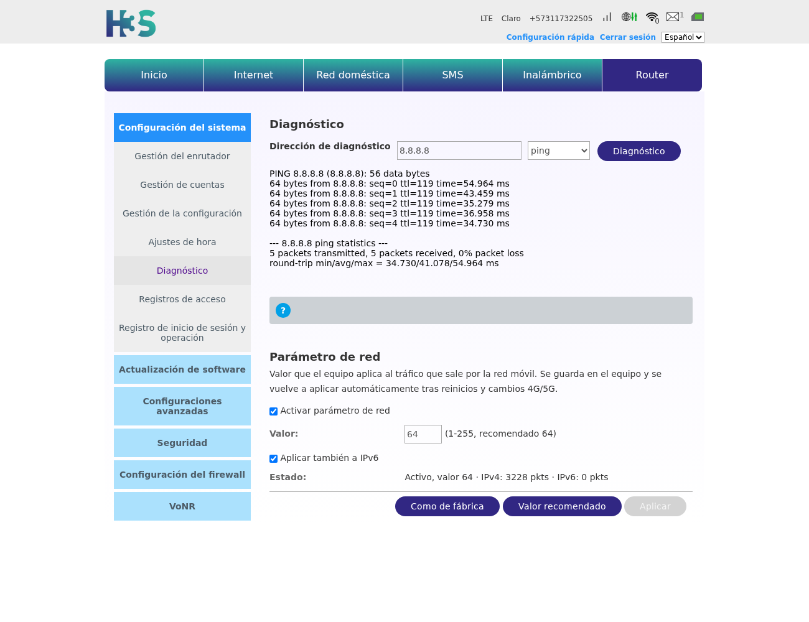

# Feature request: user-configurable outbound TTL / Hop Limit (Notion 5G, H3S P52HL, ASR1901)

**Requested by:** H3S (Colombia) · **Target:** next firmware build for the Notion 5G CPE
**Status:** fully working reference implementation running on a production unit (firmware built 2026-08-17).
Everything below was tested on real hardware. The integration can copy it as-is, or reimplement it natively.

**To implement it, follow `IMPLEMENTATION.md`** (step-by-step procedure and sign-off checklist). The final state
of the device is defined in `REQUIREMENTS.md`. This document is the full specification behind both.



## 0. File manifest — what goes where

All destination paths are **absolute paths inside the device image**. Everything lives under **`/system/etc`**:
`/www` and `/etc/config` are only symlinks into it (`/www -> /system/etc/www`,
`/etc/config -> ../system/etc/config`). **Do not put files directly in `/etc`**: it is the read-only squashfs.

The `files/` folder of this package mirrors the device filesystem exactly: `files/system/etc/X` is
`/system/etc/X` on the device. It holds the final version of every file in this section (rows 1–10), ready to
copy into the image.

### 0.1 NEW files to add to the image

| # | Source in this package | Destination in image | Mode | Type | Option A | Option B |
|---|---|---|---|---|---|---|
| 1 | `files/system/etc/config/netparam` | `/system/etc/config/netparam` | 0644 | Configuration, factory default | ✔ | ✔ |
| 2 | `files/system/etc/firewall.netparam.sh` | `/system/etc/firewall.netparam.sh` | 0755 | Firewall script, applies the rules | ✔ | ✔ |
| 3 | `files/system/etc/www/html/router/netparam.html` | `/system/etc/www/html/router/netparam.html` | 0644 | **Web UI** section markup (shown inside Diagnostics) | ✔ | ✔ |
| 4 | `files/system/etc/www/js/panel/router/netparam.js` | `/system/etc/www/js/panel/router/netparam.js` | 0644 | **Web UI** logic, and the hook that adds the section to Diagnostics | ✔ | ✔ (change calls to `PostXml`) |
| 5 | `files/system/etc/www/netparam.cgi` | `/system/etc/www/netparam.cgi` | 0755 | Web backend (shell CGI) | ✔ | ✘ not needed |

### 0.2 EXISTING files to modify

The modified files are in `files/` (factory file plus the change). The change alone is in
`merge/web-ui-existing-files.patch` (unified diff against the factory files) and `merge/i18n/`.

| # | File in image | Type | Change |
|---|---|---|---|
| 6 | `/system/etc/www/index.html` | **Web UI** | Add 1 line right after the `js/panel/router/sipalg.js` line: `<script type="text/javascript" src="js/panel/router/netparam.js" language="javascript"></script>` |
| 7 | `/system/etc/www/properties/Messages_es.properties` | **Web UI** text (Spanish) | Append the 15 lines of `merge/i18n/Messages_es.properties` |
| 8 | `/system/etc/www/properties/Messages_en.properties` | **Web UI** text (English) | Append the 15 lines of `merge/i18n/Messages_en.properties` |
| 9 | `/system/etc/www/properties/Messages_cn.properties` | **Web UI** text (Chinese) | Append the 15 lines of `merge/i18n/Messages_cn.properties` |
| 10 | `/system/etc/config/firewall` (factory default) | Firewall config | Append the section below |

**Do not** add a menu entry: `/system/etc/www/xml/ui_mifi.xml` stays as it is. The setting has no menu item of
its own. It appears as a section at the bottom of the existing **Diagnostics** page (see section 4). Do not
modify `diagnostics.html` or `diagnostics.js` either: `netparam.js` adds the section at runtime.

Section to append to `/system/etc/config/firewall`:

```
config include 'netparam'
	option type 'script'
	option path '/system/etc/firewall.netparam.sh'
	option reload '1'
	option family 'any'
```

### 0.3 Files NOT to put in the image

Everything outside `files/`: the documents, `MANIFEST.md5`, `VERSION.txt`, `merge/` and `tools/`
(field installer over SSH, verification and tests, run from a PC).

### 0.4 Final check on the device

```
ls -l /system/etc/config/netparam /system/etc/firewall.netparam.sh \
      /www/html/router/netparam.html /www/js/panel/router/netparam.js /www/netparam.cgi
uci show netparam; uci show firewall.netparam
iptables -t mangle -S | grep netparam     # expect 3 rules (POSTROUTING, INPUT, FORWARD): --ttl-set 64
ip6tables -t mangle -S | grep netparam    # expect 3 rules: --hl-set 64
```

`tools/verify.sh` runs these checks and the rest of REQUIREMENTS.md R0–R8 automatically.

## 1. What we need

1. The TTL (IPv4) and the Hop Limit (IPv6) of every packet that **leaves through the cellular interface** must be
   rewritten to a **configurable value**. Default: **64**, the same as an Android/iOS handset.
2. The value is **stored in a configuration file**: a uci config, kept across reboots, included in the
   configuration backup and restore, and set back to the default by a factory reset.
3. The user can change it from the **web UI**, in a section at the bottom of the existing Diagnostics page:
   Router → System Settings → Diagnostics → "Network parameter".
4. **UI wording (product requirement):** the visible UI text must not contain the words "TTL" or "Hop Limit" in
   any language. The setting is labelled "Network parameter" / "Parámetro de red" / "网络参数" and the field
   "Value". Use the strings in `merge/i18n/` exactly as provided.
5. **Internal names (product requirement):** nothing a user or an operator can see on the device may name the
   feature either. Everything uses the neutral name **`netparam`**: the files (`netparam.cgi`, `netparam.js`,
   `netparam.html`, `firewall.netparam.sh`), the uci config `/etc/config/netparam` (option `value`, not `ttl`),
   the fw3 include `firewall.netparam`, the iptables comment, the syslog tag, the JSON fields, the element ids
   and the string keys. The files served to the browser (`netparam.js`, `netparam.html`) and the JSON must not
   contain the words "ttl" or "hop limit", not even in comments. Keep these names if you reimplement it.
6. The value must **stay in force** after reboots, SIM changes, and every 4G ↔ 5G (NSA/SA) re-attach.

Why: some operators find tethering or CPE traffic by its TTL, which is 63 after one forwarding hop instead of 64.
They throttle or block it. Distributors have to be able to set the value per operator from the UI without SSH.

## 2. Configuration file — `/etc/config/netparam`

```
config netparam 'main'
	option enabled '1'        # 0|1  apply or not
	option value '64'         # 1..255  TTL / Hop Limit
	option ipv6 '1'           # 0|1  also set IPv6 Hop Limit
	option iface 'ccinet+'    # egress interface pattern (cellular data interfaces)
	option inbound '1'        # 0|1  also rewrite incoming packets (so a ping shows the value)
```

The file must ship in the factory defaults. The firewall script below treats a missing option as its default value.

## 3. Applying the rules (firewall script)

File: `files/system/etc/firewall.netparam.sh` in this package. It reads the uci file and then:

```
iptables  -t mangle -I POSTROUTING -o ccinet+ -m comment --comment netparam -j TTL --ttl-set <value>
ip6tables -t mangle -I POSTROUTING -o ccinet+ -m comment --comment netparam -j HL  --hl-set  <value>
```

With `inbound=1` (default) it also rewrites incoming packets, in the INPUT chain (packets to the device itself,
for example the Diagnostics ping) and the FORWARD chain (packets to LAN clients):

```
iptables  -t mangle -I INPUT   -i ccinet+ -m comment --comment netparam -j TTL --ttl-set <value>
iptables  -t mangle -I FORWARD -i ccinet+ -m comment --comment netparam -j TTL --ttl-set <value>
(and the same with ip6tables -j HL --hl-set <value> when ipv6=1)
```

This is only for confirmation: a ping, from the device or from a LAN client, then shows the configured value.
The operator never sees incoming packets after they arrive, so it has no effect on the network side.
FORWARD runs after the kernel decrements, so LAN clients see exactly `<value>`, not `<value> - 1`.

Before inserting, it deletes **every** existing rule tagged `netparam` in any mangle chain, so changing the value never leaves a
stale rule behind. With `enabled=0` it only deletes the rules.

It is registered as a fw3 include:

```
uci set firewall.netparam=include
uci set firewall.netparam.type=script
uci set firewall.netparam.path=/system/etc/firewall.netparam.sh
uci set firewall.netparam.reload=1                            # REQUIRED, see below
uci set firewall.netparam.family=any
```

**Important findings from testing**

- `reload=1` is **mandatory**. On every cellular re-attach (4G↔5G, network loss, SIM change), `wan0` does an
  ifup, and `/etc/hotplug.d/iface/20-firewall` then runs `fw3 reload`, which flushes the mangle table. Rules added
  any other way are lost within minutes. `/etc/firewall.user` is not usable either, because it sits on the
  read-only squashfs.
- The rule must be in **POSTROUTING** with `-o ccinet+`. POSTROUTING runs after the kernel decrements the TTL on
  forwarding, so the value set here is exactly what goes out on the radio. Rules without `-o`, or rules in
  PREROUTING, also change LAN-side traffic, which is not wanted.
- Kernel modules required, already present in the current image: `xt_TTL` / `ipt_TTL`, `xt_HL` / `ip6t_HL`, and
  `xt_comment`.
- Verified on hardware: the setting stayed in force across a reboot, a SIM change (Tigo → Movistar → Claro),
  multimode (5G-NSA B2+n78), and LTE-only (B28). `logread` shows the rule re-applied in under 1 s after
  "Reloading firewall due to ifup of wan0".

## 4. Web UI

Reference files, which follow the existing UI conventions (same structure as `sipalg.js` / `sipalg.html`):

| File | Purpose |
|---|---|
| `www/html/router/netparam.html` | section markup (ids `lt_*` are localized by `LocalAllElement()`) |
| `www/js/panel/router/netparam.js` | `$.fn.objNetParam` object, plus the hook that appends the section to the Diagnostics page |
| `www/netparam.cgi` | backend endpoint, a shell CGI (GET = read, POST = save and apply; `action=restore` / `action=remove` for the two extra buttons) |
| `merge/web-ui-existing-files.patch` | the only changes to existing firmware files: 1 `<script>` line in `index.html` and 15 strings appended to each of `Messages_{es,en,cn}.properties` |

### Where each piece goes in your firmware tree

Everything follows the existing **SIP ALG** page (Router → Security), which has the same shape: one setting and
an Apply button. We analyzed the installed image (web server, config, pages), not your source code.

| Piece | Your existing equivalent (SIP ALG) | TTL reference implementation | Same convention? |
|---|---|---|---|
| Page markup | `/www/html/router/sipalg.html` | `/www/html/router/netparam.html` | Yes |
| Page logic | `/www/js/panel/router/sipalg.js` (`$.fn.objSIPALG`) | `/www/js/panel/router/netparam.js` (`$.fn.objNetParam`) | Yes |
| Script include | `<script>` line in `/www/index.html` | one line right after `sipalg.js` | Yes |
| Placement | own `<ThirdlevelMenu>` in `/www/xml/ui_mifi.xml` | **no menu entry**: a section appended to the Diagnostics page (`objDiagnostics`) | Different, on purpose (see below) |
| UI strings | `/www/properties/Messages_{es,en,cn}.properties` | 15 `lt_NetParam_*` keys per file | Yes |
| Configuration | uci under `/etc/config/` (`/system/etc/config`) | `/etc/config/netparam` | Yes |
| Firewall rules | fw3, `/etc/config/firewall` | fw3 `include` in `/etc/config/firewall` | Yes (standard OpenWrt) |
| **Backend** | `xml_action.cgi` → ubus object `firewall`, served by **`/usr/bin/router`** (`fw_get_sip_alg_enable` / `fw_set_sip_alg_enable`) | `/www/netparam.cgi` (shell CGI) | **No**: the only difference (see Option B) |

On the web side `/www` is a symlink to `/system/etc/www`. We also checked that the current firmware has **no
existing TTL support**: `/usr/bin/router` has no TTL or Hop Limit strings, and no page or config mentions it. This
is a new feature, not a hidden option to enable.

### Placement inside the Diagnostics page

The setting lives inside the factory Diagnostics page (Router → System Settings → Diagnostics,
`mdiagnostics_ping` / `$.fn.objDiagnostics`, files `html/router/diagnostics.html` and
`js/panel/router/diagnostics.js`), below the ping / nslookup / traceroute form. How the reference does it,
without editing the Diagnostics files:

1. `netparam.js` is loaded by `index.html` like any other panel script.
2. On document ready it wraps `$.fn.objDiagnostics`: after the original `onLoad(flag)` has rendered the page
   with `LoadWebPage()`, it appends `<div id="NetParamSection">` with the content of
   `html/router/netparam.html` (loaded with `CallHtmlFile()`) to `#Content`, calls `LocalAllElement()`, and
   binds the handlers.
3. The ping / nslookup / traceroute function of the page is unchanged (tested).

If you prefer, you can instead put the markup of `netparam.html` directly at the end of `diagnostics.html`
and call the init code from `objDiagnostics.onLoad`. The result must look the same: one page, Diagnostics on
top, "Network parameter" below it, no separate menu entry.

### Option A: ship the reference implementation as-is (least effort)

Add files 1–5 and modify files 6–10 exactly as listed in section 0. The CGI:

- Authenticates with the **same libcgi session** as the rest of the UI. It reads the cookie `CGISID` and
  requires `/tmp/cgisess_<id>` to contain `log_status=login`. Otherwise it returns HTTP 401, and the JS sends the
  user back to the login page.
- Protects against CSRF: a POST without the `X-Requested-With` header is rejected with 403.
- Handles the two extra buttons of the section, each confirmed first with the firmware's own Yes/No dialog
  (`#confirmDlg`):
  - **Recommended value** (`action=restore`): back to the factory defaults: enabled, 64, IPv6 on. The rules are re-applied.
  - **Factory behavior** (`action=remove`): disabled and the rules deleted, as the factory firmware behaves:
    each client keeps its own TTL minus 1 (Windows 127, phones/Linux/macOS 63). The stored value is reset to 64, so enabling it again starts from the default.
- Validates strictly: `value` must be digits only and in the range 1..255, and `enabled`/`ipv6`/`inbound` must be 0 or 1.
  Anything else returns 400. Leading zeros are removed as text, never with shell arithmetic, because
  `$((064))` is octal (52). We hit that bug during testing.
- Saves with `uci set` + `uci commit netparam`, logs to syslog (`logger -t netparam`), then runs the
  firewall script directly. It does not run a full `fw3 reload`, to avoid disrupting traffic.

### Option B: native integration (preferred if you maintain `xml_action.cgi`)

Add two methods to the existing `firewall` object that `xml_action.cgi` already dispatches (the same one that
serves `fw_get_sip_alg_enable` / `fw_set_sip_alg_enable`):

| obj_path | obj_method | request (`RGW/...`) | response |
|---|---|---|---|
| `firewall` | `fw_get_netparam` | — | `<enabled>`, `<value>`, `<ipv6>`, `<inbound>` |
| `firewall` | `fw_set_netparam` | `RGW/firewall/enabled`, `RGW/firewall/value`, `RGW/firewall/ipv6`, `RGW/firewall/inbound` | `<setting_response>OK</setting_response>` |

The set handler validates the values, writes the uci options (they may live in `firewall.@defaults[0]` next
to `sip_alg_enable` instead of a separate file, if you prefer), and re-applies the rules. With this option, the
JS calls `PostXml("firewall","fw_get_netparam")` and `PostXml("firewall","fw_set_netparam",configMap)` like every other
page, and `netparam.cgi` is not needed. Keep the placement inside Diagnostics, the element ids, the panel
`objNetParam`, and the `lt_NetParam_*` string keys, so our documentation and tests still match.

Also recommended:
- Include `/etc/config/netparam` in the configuration backup and restore (`conf_management`).
- Expose `netparam.main.value` / `enabled` in TR-069, if your data model allows vendor parameters.

## 5. Acceptance tests

`tools/test_cgi.py` in this package automates 1–6 against the reference CGI.

1. No session → 401. A forged `CGISID` → 401.
2. POST without `X-Requested-With` → 403.
3. `value` = 0, 256, 300, `000`, `6;reboot` → 400, and nothing changes.
4. `value=65` → `iptables -t mangle -S POSTROUTING` shows `--ttl-set 65`, and `ip6tables` shows `--hl-set 65`.
5. `value=010` saves 10, and `value=064` saves 64. This checks that the value is not read as octal.
6. `enabled=0` → no `netparam` rules remain. `enabled=1` → the rules come back. `inbound=0` → only the
   POSTROUTING rules; `inbound=1` → also INPUT and FORWARD, and `ping 8.8.8.8` on the device shows `ttl=<value>`.
7. `fw3 reload` (equivalent to a 4G↔5G change) → the rules are still there, with the configured value.
8. Reboot → the rules are there, with the configured value.
9. Factory reset → the value is back to 64 and enabled.
10. The packet counter on the rule increases with LAN client traffic:
    `iptables -t mangle -L POSTROUTING -v -n`.
11. UI: Router → System Settings → Diagnostics shows the "Network parameter" section below the ping form, in
    ES/EN/CN, and Apply shows the success dialog. A value of 999 shows the validation message. There is no
    separate menu entry, the words "TTL" and "Hop Limit" appear nowhere on screen, and ping still works. "Apply" is
    disabled (grey) until the user changes something, and greys out again after a successful save.
12. UI: "Factory behavior" asks Yes/No; "No" changes nothing; "Yes" leaves no `netparam` rules and the section shows
    "Disabled". "Recommended value" asks Yes/No; "Yes" leaves 64 on IPv4 and IPv6, enabled. `action=` with any other value → 400.

## 6. Package contents

```
IMPLEMENTATION.md          step-by-step implementation instructions and sign-off checklist
REQUIREMENTS.md            final state of the device (R0-R12) and how to check it
OEM-SPEC.md                this document
screenshot-netparam.png    how the section must look
MANIFEST.md5               expected MD5 of the files on the device (REQUIREMENTS.md R0)
VERSION.txt                package version and source revision
files/                     the final files at their exact path on the device (rows 1-10 of section 0)
merge/apply-to-rootfs.sh   merges the changes into your own versions of the modified files
merge/i18n/                the 15 UI strings per language
merge/web-ui-existing-files.patch   the changes to the existing files, as a unified diff
tools/verify.sh            checks a unit against REQUIREMENTS.md R0-R8 (uses tools/verify-device.sh)
tools/test_cgi.py          acceptance tests 1-7
tools/test_ui.py           web UI test in Chromium (Playwright): tests 11-12 plus ES/EN/CN switching
tools/install.sh           installs/removes on a running unit over SSH (evaluation, not for the build)
tools/rsh.sh, tools/web_login.py   helpers for the tools above
```
