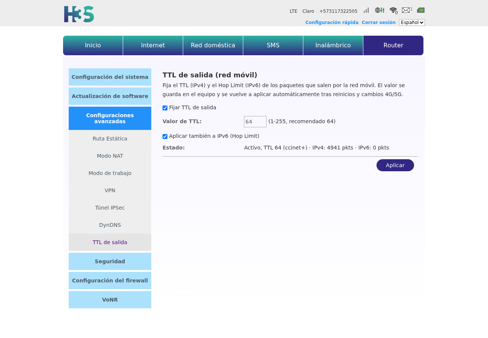

# Solicitud de función: TTL / Hop Limit de salida configurable por el usuario (Notion 5G, H3S P52HL, ASR1901)

**Solicitado por:** H3S (Colombia) · **Para:** la próxima versión de firmware del CPE Notion 5G
**Estado:** implementación de referencia completa, funcionando en un equipo de producción (firmware compilado el
2026-08-17). Todo lo que sigue se probó en hardware real. La integración puede copiarla tal cual o reimplementarla
de forma nativa.



## 1. Qué necesitamos

1. El TTL (IPv4) y el Hop Limit (IPv6) de todo paquete que **sale por la interfaz celular** deben reescribirse a un
   **valor configurable**. Valor por defecto: **64**, igual que un celular Android/iOS.
2. El valor se **guarda en un archivo de configuración**: un archivo uci que se conserva tras reinicios, entra en
   el respaldo y la restauración de configuración, y vuelve al valor por defecto con un reset de fábrica.
3. El usuario puede cambiarlo desde la **interfaz web**: Router → Configuraciones avanzadas → "TTL de salida".
4. El valor debe **seguir aplicado** tras reinicios, cambios de SIM y cada re-attach 4G ↔ 5G (NSA/SA).

Motivo: algunos operadores detectan el tráfico compartido o de un CPE por su TTL, que llega en 63 después de un
salto de reenvío en lugar de 64. Ese tráfico lo limitan o lo bloquean. Los distribuidores tienen que poder ajustar
el valor por operador desde la interfaz, sin SSH.

## 2. Archivo de configuración — `/etc/config/notion_ttl`

```
config ttl 'main'
	option enabled '1'        # 0|1  aplicar o no
	option ttl '64'           # 1..255
	option ipv6 '1'           # 0|1  fijar también el Hop Limit de IPv6
	option iface 'ccinet+'    # patrón de interfaz de salida (interfaces de datos celulares)
```

El archivo debe venir en los valores de fábrica. El script de firewall de abajo usa el valor por defecto de
cualquier opción que falte.

## 3. Aplicación de las reglas (script de firewall)

Archivo: `rootfs/system/etc/firewall.notion-ttl.sh` en este paquete. Lee el archivo uci y luego aplica:

```
iptables  -t mangle -I POSTROUTING -o ccinet+ -m comment --comment notion-ttl -j TTL --ttl-set <ttl>
ip6tables -t mangle -I POSTROUTING -o ccinet+ -m comment --comment notion-ttl -j HL  --hl-set  <ttl>
```

Antes de insertar, borra **todas** las reglas existentes marcadas `notion-ttl`, así que cambiar el valor nunca deja
una regla vieja. Con `enabled=0` solo borra las reglas.

Se registra como un include de fw3:

```
uci set firewall.notion_ttl=include
uci set firewall.notion_ttl.type=script
uci set firewall.notion_ttl.path=/etc/firewall.notion-ttl.sh    # /system/etc/... en la imagen actual
uci set firewall.notion_ttl.reload=1                            # OBLIGATORIO, ver abajo
uci set firewall.notion_ttl.family=any
```

**Hallazgos importantes de las pruebas**

- `reload=1` es **obligatorio**. En cada re-attach celular (4G↔5G, pérdida de red, cambio de SIM), `wan0` hace
  ifup y entonces `/etc/hotplug.d/iface/20-firewall` ejecuta `fw3 reload`, que vacía la tabla mangle. Las reglas
  puestas de cualquier otra forma se pierden en minutos. `/etc/firewall.user` tampoco sirve, porque está en el
  squashfs de solo lectura.
- La regla debe ir en **POSTROUTING** con `-o ccinet+`. POSTROUTING corre después de que el kernel decrementa el
  TTL al reenviar, así que el valor fijado aquí es exactamente el que sale por la radio. Las reglas sin `-o`, o en
  PREROUTING, también cambian el tráfico del lado LAN, y eso no se quiere.
- Módulos de kernel necesarios, ya presentes en la imagen actual: `xt_TTL` / `ipt_TTL`, `xt_HL` / `ip6t_HL` y
  `xt_comment`.
- Verificado en hardware: la configuración siguió aplicada tras un reinicio, un cambio de SIM (Tigo → Movistar →
  Claro), modo multimodo (5G-NSA B2+n78) y solo LTE (B28). `logread` muestra la regla reaplicada en menos de 1 s
  después de "Reloading firewall due to ifup of wan0".

## 4. Interfaz web

Archivos de referencia, que siguen las convenciones de la interfaz existente (misma estructura que `sipalg.js` /
`sipalg.html`):

| Archivo | Función |
|---|---|
| `www/html/router/notion_ttl.html` | marcado de la página (los ids `lt_*` los traduce `LocalAllElement()`) |
| `www/js/panel/router/notion_ttl.js` | objeto de panel `$.fn.objNotionTTL` |
| `www/notion_ttl.cgi` | endpoint del backend, un CGI en shell (GET = leer, POST = guardar y aplicar) |
| `web-ui-existing-files.patch` | los únicos cambios a archivos existentes del firmware: 1 línea `<script>` en `index.html`, 1 `<ThirdlevelMenu>` en `xml/ui_mifi.xml`, 11 textos agregados al final de cada `Messages_{es,en,cn}.properties` |

### Dónde va cada pieza en el árbol del firmware

Todo sigue la página existente de **SIP ALG** (Router → Seguridad), que tiene la misma forma: un ajuste y un botón
Aplicar. Analizamos la imagen instalada en el equipo (servidor web, configuración, páginas), no su código fuente.

| Pieza | Equivalente existente (SIP ALG) | Implementación de referencia del TTL | ¿Misma convención? |
|---|---|---|---|
| Marcado de la página | `/www/html/router/sipalg.html` | `/www/html/router/notion_ttl.html` | Sí |
| Lógica de la página | `/www/js/panel/router/sipalg.js` (`$.fn.objSIPALG`) | `/www/js/panel/router/notion_ttl.js` (`$.fn.objNotionTTL`) | Sí |
| Carga del script | línea `<script>` en `/www/index.html` | una línea justo después de `sipalg.js` | Sí |
| Entrada del menú | `<ThirdlevelMenu>` en `/www/xml/ui_mifi.xml` | entrada después de `mWifiDDNS` (Configuraciones avanzadas) | Sí |
| Textos de la interfaz | `/www/properties/Messages_{es,en,cn}.properties` | 11 claves `lt_NotionTTL_*` / `mNotionTTL` por archivo | Sí |
| Configuración | uci en `/etc/config/` (`/system/etc/config`) | `/etc/config/notion_ttl` | Sí |
| Reglas del firewall | fw3, `/etc/config/firewall` | `include` de fw3 en `/etc/config/firewall` | Sí (estándar OpenWrt) |
| **Backend** | `xml_action.cgi` → objeto ubus `firewall`, atendido por **`/usr/bin/router`** (`fw_get_sip_alg_enable` / `fw_set_sip_alg_enable`) | `/www/notion_ttl.cgi` (CGI en shell) | **No**: es la única diferencia (ver Opción B) |

En el lado web, `/www` es un enlace simbólico a `/system/etc/www`. También comprobamos que el firmware actual **no
trae soporte de TTL**: `/usr/bin/router` no contiene textos de TTL ni de Hop Limit, y ninguna página ni archivo de
configuración lo menciona. Es una función nueva, no una opción escondida que haya que activar.

### Opción A: incluir la implementación de referencia tal cual (menor esfuerzo)

Copiar los archivos de `rootfs/` a la imagen y aplicar `web-ui-existing-files.patch`. El CGI:

- Se autentica con la **misma sesión libcgi** que el resto de la interfaz. Lee la cookie `CGISID` y exige que
  `/tmp/cgisess_<id>` contenga `log_status=login`. Si no, responde HTTP 401 y el JS devuelve al usuario a la
  página de login.
- Se protege contra CSRF: un POST sin el header `X-Requested-With` se rechaza con 403.
- Valida de forma estricta: `ttl` debe ser solo dígitos y estar entre 1 y 255, y `enabled`/`ipv6` deben ser 0 o 1.
  Cualquier otra cosa responde 400. Los ceros a la izquierda se quitan como texto, nunca con aritmética de shell,
  porque `$((064))` es octal (52). Ese bug apareció durante las pruebas.
- Guarda con `uci set` + `uci commit notion_ttl`, deja registro en syslog (`logger -t notion-ttl`) y luego ejecuta
  directamente el script de firewall. No hace un `fw3 reload` completo, para no interrumpir el tráfico.

### Opción B: integración nativa (preferida si ustedes mantienen `xml_action.cgi`)

Agregar dos métodos al objeto `firewall` que `xml_action.cgi` ya despacha (el mismo que atiende
`fw_get_sip_alg_enable` / `fw_set_sip_alg_enable`):

| obj_path | obj_method | petición (`RGW/...`) | respuesta |
|---|---|---|---|
| `firewall` | `fw_get_ttl` | — | `<enabled>`, `<ttl>`, `<ipv6>` |
| `firewall` | `fw_set_ttl` | `RGW/firewall/enabled`, `RGW/firewall/ttl`, `RGW/firewall/ipv6` | `<setting_response>OK</setting_response>` |

El manejador de escritura valida los valores, escribe las opciones uci (si lo prefieren, pueden ir en
`firewall.@defaults[0]` junto a `sip_alg_enable` en lugar de un archivo aparte) y reaplica las reglas. Con esta
opción, el JS llama a `PostXml("firewall","fw_get_ttl")` y `PostXml("firewall","fw_set_ttl",configMap)` como
cualquier otra página, y `notion_ttl.cgi` no hace falta. Por favor conserven el id de menú `mNotionTTL`, el panel
`objNotionTTL` y las claves de texto `lt_NotionTTL_*`, para que nuestra documentación y pruebas sigan coincidiendo.

Recomendado además:
- Incluir `/etc/config/notion_ttl` en el respaldo y la restauración de configuración (`conf_management`).
- Exponer `notion_ttl.main.ttl` / `enabled` en TR-069, si su modelo de datos permite parámetros de fabricante.

## 5. Pruebas de aceptación

`test_cgi.py`, incluido en este paquete, automatiza las pruebas 1–6 contra el CGI de referencia.

1. Sin sesión → 401. Un `CGISID` falsificado → 401.
2. POST sin `X-Requested-With` → 403.
3. `ttl` = 0, 256, 300, `000`, `6;reboot` → 400, y nada cambia.
4. `ttl=65` → `iptables -t mangle -S POSTROUTING` muestra `--ttl-set 65`, e `ip6tables` muestra `--hl-set 65`.
5. `ttl=010` guarda 10, y `ttl=064` guarda 64. Esto comprueba que el valor no se lee como octal.
6. `enabled=0` → no queda ninguna regla `notion-ttl`. `enabled=1` → las reglas vuelven.
7. `fw3 reload` (equivale a un cambio 4G↔5G) → las reglas siguen ahí, con el valor configurado.
8. Reinicio → las reglas están ahí, con el valor configurado.
9. Reset de fábrica → el valor vuelve a 64 y activado.
10. El contador de paquetes de la regla sube con el tráfico de los clientes LAN:
    `iptables -t mangle -L POSTROUTING -v -n`.
11. Interfaz: Router → Configuraciones avanzadas → "TTL de salida" se muestra en ES/EN/CN, y Aplicar muestra el
    diálogo de éxito. Un valor de 999 muestra el mensaje de validación.

## 6. Contenido del paquete

```
firmware-mods/notion-ttl/
  OEM-SPEC.md / OEM-SPEC.es.md        este documento (inglés / español)
  screenshot-ttl-page.png
  web-ui-existing-files.patch         diff contra index.html / ui_mifi.xml / Messages_*.properties de fábrica
  rootfs/system/etc/config/notion_ttl
  rootfs/system/etc/firewall.notion-ttl.sh
  rootfs/system/etc/www/notion_ttl.cgi
  rootfs/system/etc/www/html/router/notion_ttl.html
  rootfs/system/etc/www/js/panel/router/notion_ttl.js
  i18n/Messages_{es,en,cn}.properties  textos que se agregan a los archivos de propiedades del firmware
  install.sh                          instala/quita en un equipo en funcionamiento por SSH (uso en campo, no para la compilación)
  test_cgi.py                         pruebas de aceptación 1–7
  test_ui.py                          prueba de la interfaz en Chromium (Playwright): prueba 11 y cambio ES/EN/CN
```
