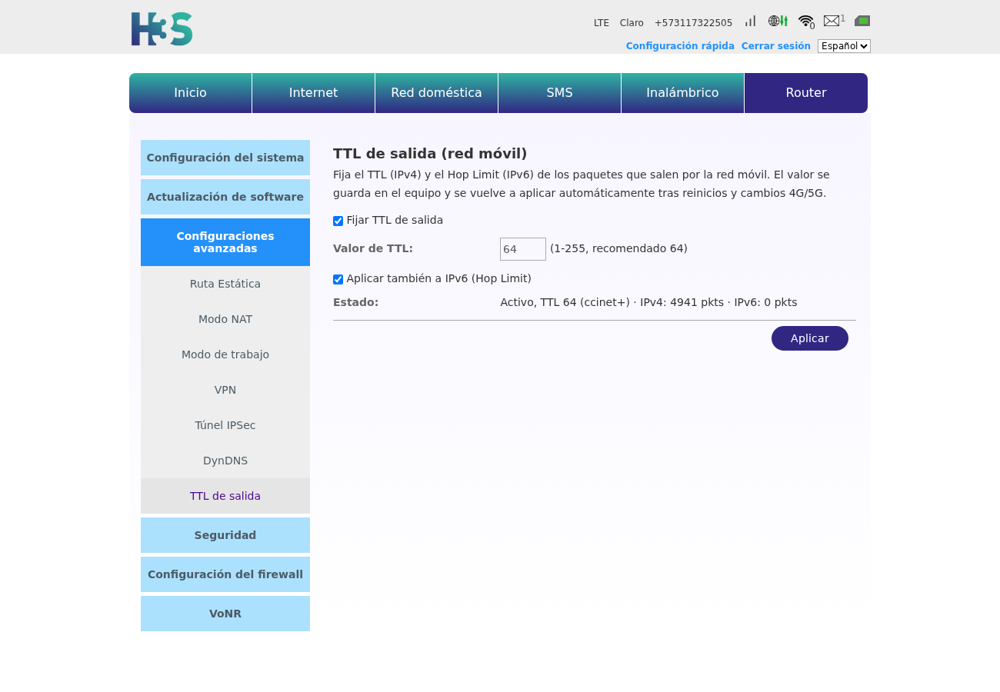

# Feature request: user-configurable outbound TTL / Hop Limit (Notion 5G, H3S P52HL, ASR1901)

**Requested by:** H3S (Colombia) · **Target:** next firmware build for the Notion 5G CPE
**Status:** fully working reference implementation running on a production unit (firmware built 2026-08-17).
Everything below was tested on real hardware. The integration can copy it as-is, or reimplement it natively.



## 1. What we need

1. The TTL (IPv4) and the Hop Limit (IPv6) of every packet that **leaves through the cellular interface** must be
   rewritten to a **configurable value**. Default: **64**, the same as an Android/iOS handset.
2. The value is **stored in a configuration file**: a uci config, kept across reboots, included in the
   configuration backup and restore, and set back to the default by a factory reset.
3. The user can change it from the **web UI**: Router → Advanced Settings → "Outbound TTL".
4. The value must **stay in force** after reboots, SIM changes, and every 4G ↔ 5G (NSA/SA) re-attach.

Why: some operators find tethering or CPE traffic by its TTL, which is 63 after one forwarding hop instead of 64.
They throttle or block it. Distributors have to be able to set the value per operator from the UI without SSH.

## 2. Configuration file — `/etc/config/notion_ttl`

```
config ttl 'main'
	option enabled '1'        # 0|1  apply or not
	option ttl '64'           # 1..255
	option ipv6 '1'           # 0|1  also set IPv6 Hop Limit
	option iface 'ccinet+'    # egress interface pattern (cellular data interfaces)
```

The file must ship in the factory defaults. The firewall script below treats a missing option as its default value.

## 3. Applying the rules (firewall script)

File: `rootfs/system/etc/firewall.notion-ttl.sh` in this package. It reads the uci file and then:

```
iptables  -t mangle -I POSTROUTING -o ccinet+ -m comment --comment notion-ttl -j TTL --ttl-set <ttl>
ip6tables -t mangle -I POSTROUTING -o ccinet+ -m comment --comment notion-ttl -j HL  --hl-set  <ttl>
```

Before inserting, it deletes **every** existing rule tagged `notion-ttl`, so changing the value never leaves a
stale rule behind. With `enabled=0` it only deletes the rules.

It is registered as a fw3 include:

```
uci set firewall.notion_ttl=include
uci set firewall.notion_ttl.type=script
uci set firewall.notion_ttl.path=/etc/firewall.notion-ttl.sh    # /system/etc/... on the current image
uci set firewall.notion_ttl.reload=1                            # REQUIRED, see below
uci set firewall.notion_ttl.family=any
```

**Important findings from testing**

- `reload=1` is **mandatory**. On every cellular re-attach (4G↔5G, network loss, SIM change), `wan0` does an
  ifup, and `/etc/hotplug.d/iface/20-firewall` then runs `fw3 reload`, which flushes the mangle table. Rules added
  any other way are lost within minutes. `/etc/firewall.user` is not usable either, because it sits on the
  read-only squashfs.
- The rule must be in **POSTROUTING** with `-o ccinet+`. POSTROUTING runs after the kernel decrements the TTL on
  forwarding, so the value set here is exactly what goes out on the radio. Rules without `-o`, or rules in
  PREROUTING, also change LAN-side traffic, which is not wanted.
- Kernel modules required, already present in the current image: `xt_TTL` / `ipt_TTL`, `xt_HL` / `ip6t_HL`, and
  `xt_comment`.
- Verified on hardware: the setting stayed in force across a reboot, a SIM change (Tigo → Movistar → Claro),
  multimode (5G-NSA B2+n78), and LTE-only (B28). `logread` shows the rule re-applied in under 1 s after
  "Reloading firewall due to ifup of wan0".

## 4. Web UI

Reference files, which follow the existing UI conventions (same structure as `sipalg.js` / `sipalg.html`):

| File | Purpose |
|---|---|
| `www/html/router/notion_ttl.html` | page markup (ids `lt_*` are localized by `LocalAllElement()`) |
| `www/js/panel/router/notion_ttl.js` | `$.fn.objNotionTTL` panel object |
| `www/notion_ttl.cgi` | backend endpoint, a shell CGI (GET = read, POST = save and apply) |
| `web-ui-existing-files.patch` | the only changes to existing firmware files: 1 `<script>` line in `index.html`, 1 `<ThirdlevelMenu>` in `xml/ui_mifi.xml`, 11 strings appended to each of `Messages_{es,en,cn}.properties` |

### Option A: ship the reference implementation as-is (least effort)

Copy the files from `rootfs/` into the image and apply `web-ui-existing-files.patch`. The CGI:

- Authenticates with the **same libcgi session** as the rest of the UI. It reads the cookie `CGISID` and
  requires `/tmp/cgisess_<id>` to contain `log_status=login`. Otherwise it returns HTTP 401, and the JS sends the
  user back to the login page.
- Protects against CSRF: a POST without the `X-Requested-With` header is rejected with 403.
- Validates strictly: `ttl` must be digits only and in the range 1..255, and `enabled`/`ipv6` must be 0 or 1.
  Anything else returns 400. Leading zeros are removed as text, never with shell arithmetic, because
  `$((064))` is octal (52). We hit that bug during testing.
- Saves with `uci set` + `uci commit notion_ttl`, logs to syslog (`logger -t notion-ttl`), then runs the
  firewall script directly. It does not run a full `fw3 reload`, to avoid disrupting traffic.

### Option B: native integration (preferred if you maintain `xml_action.cgi`)

Add two methods to the existing `firewall` object that `xml_action.cgi` already dispatches (the same one that
serves `fw_get_sip_alg_enable` / `fw_set_sip_alg_enable`):

| obj_path | obj_method | request (`RGW/...`) | response |
|---|---|---|---|
| `firewall` | `fw_get_ttl` | — | `<enabled>`, `<ttl>`, `<ipv6>` |
| `firewall` | `fw_set_ttl` | `RGW/firewall/enabled`, `RGW/firewall/ttl`, `RGW/firewall/ipv6` | `<setting_response>OK</setting_response>` |

The set handler validates the values, writes the uci options (they may live in `firewall.@defaults[0]` next
to `sip_alg_enable` instead of a separate file, if you prefer), and re-applies the rules. With this option, the
JS calls `PostXml("firewall","fw_get_ttl")` and `PostXml("firewall","fw_set_ttl",configMap)` like every other
page, and `notion_ttl.cgi` is not needed. Keep the menu id `mNotionTTL`, the panel `objNotionTTL`, and the
`lt_NotionTTL_*` string keys, so our documentation and tests still match.

Also recommended:
- Include `/etc/config/notion_ttl` in the configuration backup and restore (`conf_management`).
- Expose `notion_ttl.main.ttl` / `enabled` in TR-069, if your data model allows vendor parameters.

## 5. Acceptance tests

`test_cgi.py` in this package automates 1–6 against the reference CGI.

1. No session → 401. A forged `CGISID` → 401.
2. POST without `X-Requested-With` → 403.
3. `ttl` = 0, 256, 300, `000`, `6;reboot` → 400, and nothing changes.
4. `ttl=65` → `iptables -t mangle -S POSTROUTING` shows `--ttl-set 65`, and `ip6tables` shows `--hl-set 65`.
5. `ttl=010` saves 10, and `ttl=064` saves 64. This checks that the value is not read as octal.
6. `enabled=0` → no `notion-ttl` rules remain. `enabled=1` → the rules come back.
7. `fw3 reload` (equivalent to a 4G↔5G change) → the rules are still there, with the configured value.
8. Reboot → the rules are there, with the configured value.
9. Factory reset → the value is back to 64 and enabled.
10. The packet counter on the rule increases with LAN client traffic:
    `iptables -t mangle -L POSTROUTING -v -n`.
11. UI: Router → Advanced Settings → "Outbound TTL" renders in ES/EN/CN, and Apply shows the success dialog.
    A value of 999 shows the validation message.

## 6. Package contents

```
firmware-mods/notion-ttl/
  OEM-SPEC.md                         this document
  screenshot-ttl-page.png
  web-ui-existing-files.patch         diff vs factory index.html / ui_mifi.xml / Messages_*.properties
  rootfs/system/etc/config/notion_ttl
  rootfs/system/etc/firewall.notion-ttl.sh
  rootfs/system/etc/www/notion_ttl.cgi
  rootfs/system/etc/www/html/router/notion_ttl.html
  rootfs/system/etc/www/js/panel/router/notion_ttl.js
  i18n/Messages_{es,en,cn}.properties  strings appended to the firmware's property files
  install.sh                          installs/removes on a running unit over SSH (field use, not for the build)
  test_cgi.py                         acceptance tests 1–7
```
